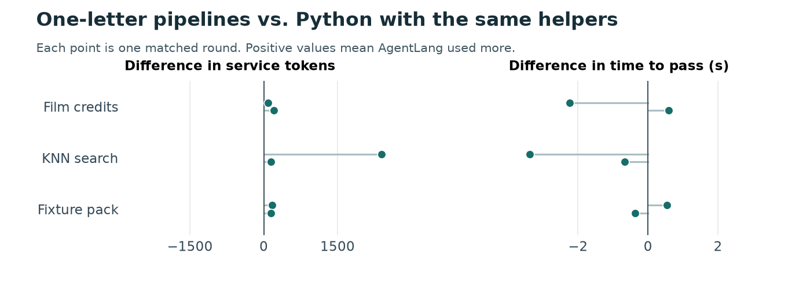

# Longer scripts, identical helpers

We asked a coding agent to write complete programs for three tasks that agents have performed. Both languages got the same CSV and JSON functions. In the one-letter experiment, Python also got the short callable names `c`, `r` and `wj`. Scripts ran on invented data with an independent reference answer.

**The one-letter programs used 7.6% fewer source tokens than the matched Python submissions.** Including service input and output increased tokens by 2.8%. Median time from model request to passing the checks fell from 12.26 to 11.40 seconds. With two rounds per task, the observed timing difference is sensitive to model output and service conditions.

## Workloads

| Task | Original agent work | First matched pair from the one-letter experiment |
| --- | --- | --- |
| Film credits | Parse nested fields from two CSVs, join film and crew records, count credits and rank crew members. Adapted from a recorded Qwen notebook. | [Python](generation/required/sources/movie_credits-python-r1-a1.py) · [AgentLang](generation/required/sources/movie_credits-compact-r1-a1.ag) |
| KNN search | Search a grid of neighbor counts, distance metrics and voting rules. Score each configuration and predict held-out labels. Adapted from a second recorded Qwen notebook. | [Python](generation/required/sources/knn_grid-python-r1-a1.py) · [AgentLang](generation/required/sources/knn_grid-compact-r1-a1.ag) |
| Fixture pack | Repeat CSV and JSON records, transform golden outputs, preserve ordering within score ties and hash the resulting bytes. Adapted from this project's 68-line Codex-authored utility. | [Python](generation/required/sources/fixture_pack-python-r1-a1.py) · [AgentLang](generation/required/sources/fixture_pack-compact-r1-a1.ag) |

The reported programs contain 40–87 physical lines across the two experiments. The public notebooks used third-party libraries. We specified standard-library implementations, deterministic tie handling and synthetic inputs for this comparison. [Source records and exact adaptations](workloads/PROVENANCE.md)

## Model generation and correctness

Thirty fresh, sequential requests used `gpt-6.2-sol` with low reasoning effort. Within each experiment, the task, helper semantics, model and grading protocol matched. Each task used both language orderings. A trial allowed an initial submission and up to two repairs after neutral test feedback. The timer includes model invocation, local translation or Python preparation, and checks on three fixture sets. Every script passed on the first attempt. A separate replay checked those three fixtures again and added a fourth, previously unseen case. All 120 replay checks passed. That extra audit is outside the reported time to pass. [Replay the accepted sources](replay.py) · [Free-choice audit](generation/observations/audit.json) · [One-letter audit](generation/required/audit.json)

| Measurement | Free choice · Python | Free choice · AgentLang | One-letter · Python | One-letter · AgentLang |
| --- | ---: | ---: | ---: | ---: |
| First-attempt passes | 9/9 | 9/9 | 6/6 | 6/6 |
| Generated source tokens | 4,291 | 3,822 | 2,637 | 2,437 |
| User prompt tokens | 3,813 | 5,118 | 2,752 | 3,850 |
| Full service input | 169,783 | 171,080 | 111,023 | 114,488 |
| Cached portion of input | 134,784 | 134,784 | 89,856 | 93,696 |
| Full service output | 4,620 | 4,081 | 2,917 | 2,610 |
| Reasoning portion of output | 285 | 217 | 248 | 145 |
| **Total service tokens** | **174,403** | **175,161** | **113,940** | **117,098** |
| **Median time to pass** | **13.15 s** | **11.35 s** | **12.26 s** | **11.40 s** |
| Time across all trials | 126.58 s | 114.24 s | 79.07 s | 73.52 s |
| Local model client CPU, total | 10.31 s | 10.23 s | 6.83 s | 6.76 s |
| Local model client peak RSS, median per request | 162.97 MiB | 163.81 MiB | 162.73 MiB | 164.39 MiB |

In the free-choice series, all nine AgentLang submissions used ordinary Python with the preloaded helpers. The observed timing and token differences in that series cannot establish a syntax effect. In the second series every AgentLang submission had to use a one-letter collection stage on task data. All six did. The experiment measures that specific instruction with its grammar overhead.

### Where did the difference come from?

| One-letter experiment, two rounds per task | Python source tokens | AgentLang source tokens | Python median time to pass | AgentLang median time to pass |
| --- | ---: | ---: | ---: | ---: |
| Film credits | 717 | 723 | 11.58 s | 10.75 s |
| KNN search | 1,151 | 960 | 16.63 s | 14.61 s |
| Fixture pack | 769 | 754 | 11.32 s | 11.40 s |

KNN accounted for 191 of the 200 net source tokens saved. AgentLang finished sooner in four of six matched rounds. Every matched AgentLang request used more service tokens. The short grammar and task instructions added 183 user-prompt tokens per request, or 1,098 overall. Full service input varied for other reasons as well. Two Python requests with the same KNN user prompt had a 2,377-token difference in their full service input. Cache hits also varied. A token sum does not determine a dollar cost or server energy use. [Exact prompts, model settings and usage](generation/README.md)



### What did the spelling itself save?

We expanded and shortened the **same six AgentLang programs**, preserving their compiled Python syntax trees after resolving equivalent helper aliases. Long spellings used 2,473 source tokens and 9,734 characters. The terse form used **2,437 tokens and 9,517 characters**, saving **36 tokens (1.46%)** and **217 characters (2.23%)**. Of those 36 tokens, 16 came from I/O aliases, eight from stage names, one from an output command and 11 from the fused delimiter and whitespace changes. The 200-token difference between separately generated Python and AgentLang programs includes algorithm and formatting choices as well.

Spelling mattered more on the four small worked examples, where it saved 13 of 137 tokens (9.5%). The spelling study includes seven renderings of 27 programs and both the original and shortened counts. [Static comparison](spellings.json) · [Reproduce the comparison](spellings.py)

## Local execution

We executed the accepted programs on an Apple M1 with CPython 3.12.4, using both the base and larger fixtures, with interleaved launch order. All 768 measured processes and 120 warmups produced the expected JSON. Each program first had to pass the reserved audit input to qualify for profiling.

The following results use the **larger input** and the **one-letter experiment** only. Values are medians across the two independently generated programs per task, after taking each program's median over four process runs. A fresh AgentLang launch includes translation. A fresh Python launch preloads the same helpers and uses native Python compilation.

| Workload | Python wall (ms) | AgentLang wall (ms) | Python CPU (ms) | AgentLang CPU (ms) | Python peak RSS (MiB) | AgentLang peak RSS (MiB) |
| --- | ---: | ---: | ---: | ---: | ---: | ---: |
| Film credits | 90.83 | 106.37 | 88.39 | 104.09 | 17.37 | 18.54 |
| KNN search | 65.92 | 110.17 | 63.80 | 107.89 | 13.46 | 15.03 |
| Fixture pack | 96.30 | 104.96 | 93.68 | 102.24 | 27.42 | 30.61 |

After preparing both arms as standalone Python files, the respective Python and AgentLang wall times were **91.70 / 98.85 ms** for film credits, **65.12 / 99.81 ms** for KNN and **93.98 / 96.63 ms** for the fixture pack. Remaining differences include the algorithms the model chose. In the first KNN pair the Python program computed and reused neighbor rankings across configurations. The AgentLang program repeated the ranking inside prediction.

The resource records also include user and system CPU separately, page faults, OS block-I/O counts, source and emitted-file sizes, workload input bytes, stdout/stderr bytes and new or changed files. [Resource methods and all four execution modes](runtime/README.md) · [One-letter raw measurements](runtime/required.json) · [Free-choice raw measurements](runtime/results.json)

## Reproduce

From the project root, install the benchmark dependencies with `python -m pip install -e '.[bench]'` in a virtual environment. These commands use the recorded sources and run locally.

```sh
python benchmarks/long/generation/summarize.py benchmarks/long/generation/required/results.json
python benchmarks/long/replay.py --trials benchmarks/long/generation/required/results.json
python benchmarks/long/spellings.py --output /tmp/agentlang-spellings.json
python benchmarks/long/runtime/run.py --runs 4 --trials benchmarks/long/generation/required/results.json --output /tmp/agentlang-runtime.json
```

The [generation harness](generation/README.md) documents how to collect new responses with an authenticated model client. The optional [figure script](plot.py) uses Matplotlib. Runtime profiling requires macOS or Linux. These experiments cover one model, one computer and three deliberately selected workloads. The measurements capture local process resources and end-to-end request time. Model-server CPU, GPU and energy telemetry were unavailable.
