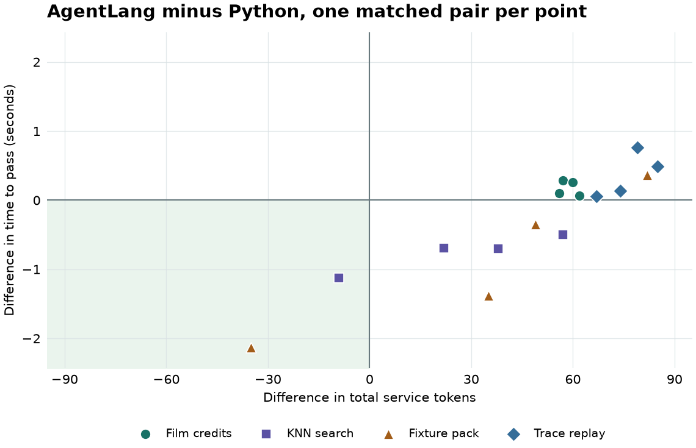

# Can the language pay for its own instructions?

We mined 30 previously accepted programs for recurring code, added compact operations, and compared fresh AgentLang submissions against native Python with identical helpers. The primary comparison is a single request for a single script, including all attempts up to the first passing result. A separate experiment measures a four-script batch. Both use full service input plus output tokens, with cached input and reasoning counted once.

## What occupied the source

Of the 13,187 source tokens in the earlier programs, 4,513 (34.2%) belonged to operators and punctuation, 3,908 (29.6%) to names, 2,011 (15.2%) to string literals and 1,372 (10.4%) to standalone layout. The remaining tokens belonged to keywords, numbers and comments. The profiler assigns each tokenizer token exactly one category. Nested syntax-tree patterns have a separate accounting. The biggest recurring syntax families included 238 tuple/list/set literals, 237 dynamic or positional indexes and slices, and 112 comprehensions or generator expressions. Existing stages already cover several comprehension patterns. The table below identifies shorter substitutions with directly measurable whole-file savings. [Token ownership and inventory](profile/README.md)

| Pattern | New form | Evidence in the archived programs |
| --- | --- | --- |
| Index a record by a literal string key | `event$run` | 135 applicable lookups. Replacing all of them saved 53 tokens after retokenizing whole files. |
| Pack local variables under their own names | `d{run,status,commands}` | 11 whole dictionaries containing 44 matching fields. Their replacements saved 79 tokens. |
| Select one best item or the first N by a key | `rows:x _$score`, `rows:t 3,-_$score` | 20 eligible extrema selections. Key-expression syntax saved 71 tokens beyond the callable helpers. Eight additional full-sort-and-slice sites could use stable top-N selection. |
| Serialize and digest bytes | `b(value)`, `h(data)` | 27 exact SHA-256 and JSON-byte replacements saved 205 tokens, all in the fixture-packaging workload. |
| Handle JSON with a Python-literal fallback | `v(text, default)` | Repeated in the movie workload. Earlier handlers differed, so the fixed-program analysis gives this helper no savings credit. |

Across the corpus, same-algorithm rewrites took 13,187 tokens down to 12,962 with shared helpers, then to **12,759 with AgentLang syntax**. That last step saved **203 tokens (1.57%)** over the helper-only version. Allowing stable heap-based top-N in both arms took the equivalent-output variants to 12,950 and 12,692. The full-sort and heap algorithms can do different amounts of work. [Exact rewrite rules, hashes and fixtures](profile/README.md)

## Fixed single-script comparison

The earlier three tasks cover a movie-credits join, a nearest-neighbor grid search and a CSV/JSON fixture pack. A fourth contract was frozen independently of mining. It requires rebuilding per-run status, commands, messages and token usage from out-of-order and duplicate JSONL events. All 16 task/round pairs were scheduled before collection. Both languages get the same semantic helper implementations and short call names. AgentLang also gets a 57-user-token syntax addendum, covering field selectors, named records and the three ranking stages. The short card leaves older pipeline stages undocumented. Each agent chooses whether to use the new syntax. [Registered prompts and protocol](generation/README.md) · [Held-out workload](evaluation/README.md)

The model was `gpt-6.2-sol` with low reasoning effort. Its submitted scripts ranged from 28 to 57 lines. The same lean CLI and empty, ephemeral session were used in both arms. In four separate neutral probes the lean configuration reduced the shared input from about 18,453 to 6,412 tokens per invocation. Those setup probes consumed 49,750 service tokens and are excluded from the workload comparison. Calibration selected on common input size, before any workload outcomes were available. [Calibration observations](generation/calibration.json)

**AgentLang did not win on both measures across single scripts.** All 32 programs passed the three timed checks on the first attempt and passed a fourth reserved audit fixture. AgentLang used 779 more service tokens (+0.68%) and 4.34 fewer seconds in total (−2.48%). It was faster in seven of sixteen pairs, and used fewer tokens in two. Both token wins were also time wins. The median within-pair time difference was 0.065 seconds slower for AgentLang. The small aggregate time difference was concentrated in a subset of programs.

| Across 16 scripts per language | Python + helpers | AgentLang |
| --- | ---: | ---: |
| First-pass / reserved-fixture passes | 16/16 | 16/16 |
| Visible source tokens | 6,033 | 5,986 |
| User prompt tokens | 6,740 | 7,652 |
| Service input (including cached input) | 109,138 | 110,050 |
| Cached portion | 59,520 | 31,104 |
| Service output (including reasoning) | 6,183 | 6,050 |
| Reasoning portion | 80 | 0 |
| **Total service tokens** | **115,321** | **116,100** |
| Total seconds to accepted scripts | 175.05 | 170.71 |
| Median seconds to acceptance | 11.28 | 11.05 |
| Total local model-client CPU (s) | 10.44 | 10.47 |
| Median model-client peak RSS (MiB) | 120.64 | 122.12 |

The AgentLang instructions added exactly 912 prompt tokens across the sixteen requests. Service output fell by 133 tokens, leaving a net increase of 779. If output stayed the same, breaking even would require an incremental instruction cost of about eight tokens per script. A shorter instruction could change the model's output. Cache rates differed appreciably and no server energy, computing cost or pricing was measured.

| Workload (4 pairs each) | Python total tokens | AgentLang total tokens | Python median time (s) | AgentLang median time (s) |
| --- | ---: | ---: | ---: | ---: |
| Film credits | 28,202 | 28,437 | 8.52 | 8.73 |
| KNN search | 29,243 | 29,351 | 12.93 | 12.19 |
| Fixture pack | 28,792 | 28,923 | 10.15 | 9.20 |
| Trace replay (held out from mining) | 29,084 | 29,389 | 12.15 | 12.41 |

Eleven of the 16 AgentLang programs executed field selectors and ten executed named records. Expanding just the selectors and records in these same 16 programs through the compiler increased their source from 5,986 to 6,179 tokens. Those forms saved 193 tokens against their own Python expansion (3.1%). The independent Python submissions used 6,033 tokens. None of the AgentLang submissions used the new ranking-stage spellings. The shared parsing, byte-encoding, hashing or ranking helpers ran in eight Python and ten AgentLang programs.

The shaded quadrant contains pairs where AgentLang used fewer total tokens and finished sooner. Each point represents one independently generated pair. [Exact candidate sources](generation/observations/sources/) · [Four-fixture replay](generation/observations/audit.json) · [Executed operations](generation/observations/features.json)



## Local performance

Programs ran in fresh processes on macOS with an Apple M1 and CPython 3.12.4. The Python launcher binds the same helper functions natively. The AgentLang launcher now compiles in memory and binds functions directly. Both prepared modes execute standalone Python. Fixture preparation and result checking are outside the runtime timer. The oracle also checks an additional strict-JSON diagnostic for the event-trace task, independently of the registered fixtures.

Across 512 measured launches, fresh AgentLang scripts took a median **7.69 ms longer (9.17%)** within a matched pair. Once compiled ahead of time they took a median **0.02 ms less (0.02%)**. Ratios and differences are medians computed separately over the same 16 pairs. One AgentLang program ran faster when launched fresh and eight ran faster when prepared.

| Held-out trace replay on 8,003 lines | Wall (ms) | CPU (ms) | Peak RSS (MiB) |
| --- | ---: | ---: | ---: |
| Python + helpers, fresh | 45.96 | 43.44 | 17.53 |
| AgentLang, fresh | 59.34 | 56.79 | 19.36 |
| Python + helpers, prepared | 45.02 | 42.46 | 17.30 |
| AgentLang, prepared | 50.00 | 47.48 | 17.34 |

All eight trace programs also passed the supplementary strict-JSON check. With six *identical* archived sources, preparing in memory took 1.085 ms against 1.172 ms through emitted Python (7.45% less). These figures exclude program execution and interpreter startup. The full profile includes time, user/system CPU, peak RSS, page faults, block I/O and bytes read or produced by the fixture workload. [Per-task tables and methodology](evaluation/README.md) · [Raw process samples](evaluation/runtime.json) · [Controlled compiler measurements](evaluation/compile-paths.json)

## Four scripts together

With all four specifications in one request, the AgentLang arm won on both measured outcomes in each of two matched rounds. It used **306 fewer total service tokens (1.61%)** and reached four correct results **10.22 seconds sooner in aggregate (12.68%)**. Both languages produced all eight requested programs on the first attempt. Every program passed the three timed fixtures and the reserved audit.

**All eight batched AgentLang submissions were valid native Python.** Each produced the same compiled syntax tree through both front ends and passed all four fixtures unchanged with the Python control. The 361-token visible-response difference therefore came from differences between independently generated programs and their formatting. This experiment establishes a measured win for the AgentLang prompt in two batches. It supplies no evidence that the dialect syntax caused that win. [Per-program native equivalence and replay](batch/observations/verification.json)

| Two batches of four per language | Python + helpers | AgentLang |
| --- | ---: | ---: |
| Total service tokens / round 1 / round 2 | 19,052 / 9,463 / 9,589 | 18,746 / 9,383 / 9,363 |
| User prompt tokens | 2,696 | 2,810 |
| Service input (cached portion) | 15,496 (4,736) | 15,612 (4,736) |
| Service output (reasoning portion) | 3,556 (115) | 3,134 (56) |
| Visible response tokens, including program headers | 3,429 | 3,068 |
| Seconds to all four correct, rounds 1 and 2 | 38.38, 42.26 | 35.46, 34.96 |
| Total seconds across both batches | 80.64 | 70.41 |
| Total local client CPU (s) | 1.77 | 1.65 |
| Median client peak RSS (MiB) | 120.48 | 124.99 |

**Sharing a request produced the largest token savings.** For the same eight specifications in the first two singleton rounds, Python used 57,715 tokens and took 89.10 seconds in series. AgentLang used 58,000 tokens and took 84.80 seconds. Batching cut each language’s total tokens by **67.0% and 67.7%**, respectively, and serial elapsed time by 9.5% and 17.0%. These are turnaround times for all eight programs in each condition. Each condition sampled new programs and ran at a different time. [Batch protocol and commands](batch/README.md) · [Exact responses and counters](batch/observations/results.json)

## Reproduce

Install the benchmark extra in a virtual environment. The following commands use the saved observations and local fixtures. Collection of fresh model outputs uses the authenticated client described in each experiment.

```sh
python -m unittest discover -s tests
python -m unittest benchmarks.patterns.evaluation.test_cases
python benchmarks/patterns/summarize.py
python benchmarks/patterns/generation/verify.py benchmarks/patterns/generation/observations/results.json --out /tmp/agentlang-verify.json
python benchmarks/patterns/batch/verify.py --out /tmp/agentlang-batch-verify.json
python benchmarks/patterns/evaluation/profile.py --output /tmp/agentlang-runtime.json
```

The saved scatter plot can be regenerated with `python benchmarks/patterns/plot.py` in an environment with Matplotlib installed.

Inference collection preceded two final compiler fixes for f-string literals and locally scoped helper names. The shipped CLI passed 128 fixture executions on the single-script candidates. The batch verifier replayed all 16 batched candidates. The process measurements use the final compiler.

The raw outputs include the original responses, per-call usage, individual process samples and checksums. [Single-script records](generation/observations/results.json) · [Runtime profiler](evaluation/README.md) · [Batch protocol](batch/README.md)
